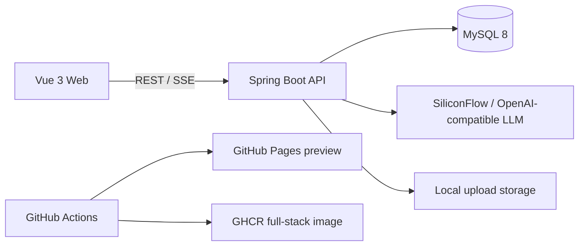

<div align="center">

# MindCare AI · 心理健康陪伴平台

一个把 AI 对话、情绪分析、情绪日记、心理知识库与运营数据看板整合在一起的全栈项目。

[在线界面预览](https://bixubtye.github.io/mindcare-ai/) · [后端容器](https://github.com/bixubtye/mindcare-ai/pkgs/container/mindcare-ai) · [部署说明](#部署与运行)

[](https://github.com/bixubtye/mindcare-ai/actions/workflows/ci.yml)
[](https://github.com/bixubtye/mindcare-ai/actions/workflows/pages.yml)
[](https://github.com/bixubtye/mindcare-ai/actions/workflows/container.yml)

</div>

## 项目亮点

- 流式 AI 心理陪伴：基于 Spring AI 对接 SiliconFlow 的 OpenAI 兼容接口，通过 SSE 实时返回内容。
- 情绪风险识别：结构化分析主要情绪、情绪强度与风险等级，并提供分级提示。
- 完整用户闭环：注册登录、JWT 鉴权、会话管理、情绪日记与心理知识库。
- 管理端能力：文章管理、咨询记录、情绪日志与聚合数据看板。
- 工程化交付：前后端自动化测试、GitHub Pages、GitHub Container Registry、Docker Compose 与初始化数据。

## 技术栈

| 层级 | 技术 |
| --- | --- |
| 前端 | Vue 3、Vite、Vue Router、Pinia、Element Plus、ECharts |
| 后端 | Java 17+、Spring Boot 4、Spring AI、Spring Security、MyBatis-Plus |
| 数据 | MySQL 8、JSON 情绪分析结果、文件上传 |
| 交付 | Docker、Docker Compose、GitHub Actions、GitHub Pages、GHCR |

## 架构



仓库采用单仓结构：

```text
mindcare-ai/
├── frontend/                  # Vue 3 前端
├── src/main/java/            # Spring Boot 后端
├── src/test/                 # 后端单元与上下文测试
├── database/                 # MySQL 建表与演示数据
├── .github/workflows/        # CI、Pages、容器发布
├── Dockerfile                # 前后端多阶段构建
└── docker-compose.yml        # 应用 + MySQL 一键启动
```

## 部署与运行

### 方式一：Docker Compose 一键运行

1. 复制环境变量模板：

   ```bash
   cp .env.example .env
   ```

2. 至少修改 `.env` 中的数据库密码、`JWT_SECRET`；需要真实 AI 对话时再填写 `SILICONFLOW_API_KEY`。

3. 启动完整应用：

   ```bash
   docker compose up --build
   ```

4. 打开 `http://localhost:8080`。首次启动会自动创建表并写入三篇演示文章。

### 方式二：本地开发

先准备 MySQL 8，并依次执行 `database/schema.sql` 和 `database/seed.sql`。

在终端或 IDE 运行配置中设置 `DB_URL`、`DB_USERNAME`、`DB_PASSWORD`、`JWT_SECRET`；需要 AI 对话时再设置 `SILICONFLOW_API_KEY`。

```bash
# backend
./mvnw spring-boot:run

# frontend (another terminal)
cd frontend
npm ci
npm run dev
```

前端开发地址是 `http://localhost:5173`，Vite 会把 `/api` 转发到 `http://localhost:8080`。

## 核心接口

| 模块 | 接口示例 |
| --- | --- |
| 认证 | `POST /api/user/add`、`POST /api/user/login` |
| AI 咨询 | `POST /api/psychological-chat/session/start`、`POST /api/psychological-chat/stream` |
| 会话 | `GET /api/psychological-chat/sessions`、`GET /api/psychological-chat/sessions/{id}/messages` |
| 情绪日记 | `POST /api/emotion-diary`、`GET /api/emotion-diary/admin/page` |
| 知识库 | `GET /api/knowledge/article/page`、`POST /api/knowledge/article` |
| 数据看板 | `GET /api/data-analytics/overview` |

## 自动化交付

- `CI`：每次 push / pull request 自动执行后端测试与前端生产构建。
- `Pages`：`main` 分支前端变更自动发布到 GitHub Pages，适合快速查看界面。
- `Container`：自动构建包含前端静态资源的 Spring Boot 镜像并推送到 GHCR。

GitHub Pages 只能托管静态资源，因此在线预览用于展示前端界面；需要体验数据库、登录和 AI 对话时，请通过 Docker Compose 或 GHCR 镜像启动完整服务。

## 验证

```bash
./mvnw test
cd frontend && npm run build
```

当前测试包含 Spring Boot 上下文测试和情绪风险分析单元测试；需要真实模型密钥的集成测试默认跳过。

## 使用边界

本项目用于技术展示与一般心理健康陪伴，不提供医学诊断，也不能替代专业心理咨询或紧急援助。若存在即时人身安全风险，请优先联系当地急救服务、危机干预热线或可信赖的人。
